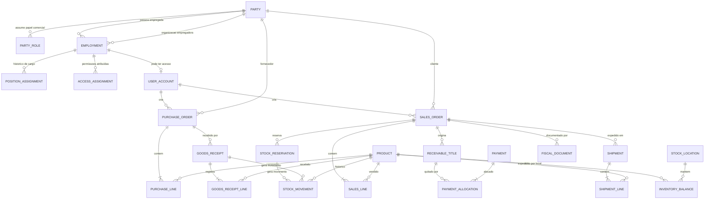

# Modelo de domínio — OpenERP Core

**Estado:** modelo conceitual proposto para o produto completo, derivado da ideia do projeto, dos requisitos e dos casos de uso. Ele descreve os conceitos e as regras do negócio; não é o esquema SQL atual. A implementação vai evoluir por etapas, começando pelo [escopo V1](ESCOPO_V1.md). As diferenças do protótipo estão anotadas no fim.

## Para que serve este modelo

O modelo de domínio nomeia as coisas com que o sistema trabalha, explica como elas se relacionam e registra as regras que não podem ser violadas. Ele ajuda a manter o mesmo significado entre requisitos, casos de uso, API, banco e código.

Este é um modelo do negócio. Ele não exige uma classe Java ou uma tabela para cada conceito. Os detalhes físicos de tabelas, índices e chaves serão definidos depois, a partir das regras e das necessidades de persistência.

## Mapa conceitual



O desenho é intencionalmente conceitual: algumas partes ainda não pertencem à V1 e algumas cardinalidades dependem das decisões listadas ao final.

## Parte e seus papéis

### Parte

**Parte** é uma pessoa física ou uma organização que participa de relações com a empresa. Ela tem uma identidade interna estável e nome; informações de contato ou identificação legal serão definidas conforme a necessidade e a política de dados.

O mesmo cadastro de Parte pode assumir mais de um papel comercial. Assim, uma organização que compra da empresa e também fornece produtos pode ser cliente e fornecedora sem duplicar sua identidade.

### Papel comercial

`PartyRole` associa uma Parte a um papel como `CLIENTE` ou `FORNECEDOR`. A relação pode incluir estado ativo e período de validade, se for necessário preservar quando o papel começou ou deixou de valer.

O **código externo** é uma referência opcional atribuída por outro sistema, como um ERP anterior. Ele não substitui o ID interno, não é SKU e não é automaticamente um documento fiscal. Cadastros locais não dependem dele.

### Funcionário, cargo e acesso

Funcionário não é apenas mais um papel de cliente/fornecedor. O vínculo de trabalho conecta uma Parte do tipo pessoa física à organização empregadora:

- **Vínculo de emprego (`Employment`):** quem trabalha para qual organização e durante qual período.
- **Cargo ou nível (`PositionAssignment`):** função ocupada ao longo do tempo, como vendedor ou supervisor. Cada mudança tem início/fim e responsável pelo registro; a mudança não apaga o histórico anterior.
- **Permissões (`AccessAssignment`):** ações autorizadas na aplicação, como criar pedido, cancelar pela regra comum ou analisar exceção. São separadas do nome do cargo; ter o título “supervisor” não concede acesso automaticamente sem uma regra explícita.
- **Conta de acesso (`UserAccount`):** credencial usada para autenticar a pessoa no sistema e associar autoria às operações.

Essa separação permite que uma pessoa mude de cargo sem reescrever transações antigas, e que as permissões sejam alteradas com controle e auditoria.

## Catálogo e procurement

### Produto

Produto representa um item comercializável. Possui ID interno, nome e SKU único gerado pelo sistema. O SKU é estável e não deriva do nome, pois o nome pode ser corrigido sem trocar a referência de estoque e dos pedidos.

As telas e clientes da API localizam o produto por nome ou SKU e enviam o ID interno selecionado. A pessoa usuária não digita um ID de banco nem precisa inventar SKU.

### Ordem de compra e itens

Uma `PurchaseOrder` registra a intenção de comprar de uma Parte com papel de fornecedor. Seus itens (`PurchaseLine`) referenciam produtos existentes e guardam quantidade pedida e custo unitário acordado/documentado pelo fornecedor.

O custo médio atual é informação de referência para quem registra a compra; ele não substitui o custo unitário documentado, pois preços podem mudar legitimamente.

### Recebimento de mercadoria

`GoodsReceipt` representa a chegada física da mercadoria vinculada à ordem. Suas linhas guardam o que foi efetivamente conferido. Recebimento aumenta o saldo físico e pode atualizar o custo médio.

O conceito de recebimento é distinto da ordem e da reserva de venda. O produto pode chegar parcialmente ou em mais de uma entrega; se isso fará parte da V1 ou de etapa posterior é uma decisão pendente.

## Estoque e rastreabilidade

### Local de estoque

`StockLocation` representa depósito ou local controlado. A primeira versão assume um único local, mas o modelo deixa a relação pronta para separar saldos quando houver necessidade de mais de um depósito.

### Saldo

`InventoryBalance` é a projeção atual por produto e local, com saldo físico, reservado e custo médio. É otimizada para consulta e transação; não substitui o histórico.

`disponível = físico − reservado`.

### Reserva

`StockReservation` liga quantidades de produtos a um pedido de venda. A reserva diminui o disponível sem baixar o físico. Pode ser liberada no cancelamento antes da expedição ou consumida na expedição.

Uma reserva de pedido com vários produtos é atômica: todas as linhas reservam ou nenhuma reserva. O saldo é revalidado e bloqueado na transação, pois pode mudar depois de uma consulta ou enquanto outro pedido está sendo criado.

### Movimentação

`StockMovement` é o livro-razão append-only: cada entrada, reserva, liberação, expedição, avaria ou ajuste permitido registra produto, local, tipo, deltas, origem, autor e data. Correções acrescentam uma movimentação compensatória em vez de alterar ou apagar o passado.

O saldo é mantido junto com a movimentação na mesma transação. Em um sistema real, também é necessário limitar permissões diretas no banco para impedir alteração de saldo sem histórico.

## Vendas e pedidos

`SalesOrder` representa a venda feita a uma Parte com papel de cliente. Guarda ID, estado, datas, autor e itens. Cada `SalesLine` referencia um produto e quantidade.

O pedido usa uma máquina de estados de negócio, com caminho principal:

```text
CRIADO → RESERVADO → PAGO → EXPEDIDO → ENTREGUE
                    ↘ CANCELADO
```

O cancelamento comum é feito por funcionário identificado antes da expedição, com motivo obrigatório. Casos fora dessa regra são encaminhados para decisão de supervisor. Cancelar um pedido pago requer tratar estorno; depois de expedir, o fluxo adequado é devolução. Esses efeitos precisam de regras financeiras e logísticas próprias.

### Idempotência

A chave de idempotência representa uma tentativa de criação, não uma regra para bloquear conteúdo duplicado. A mesma chave com o mesmo conteúdo devolve o resultado original; a mesma chave com conteúdo diferente é rejeitada; uma chave nova permite outro pedido igual se houver estoque.

A chave é gerada pelo cliente da API e reutilizada apenas para repetir a mesma intenção. A pessoa usuária não deve digitá-la.

## Financeiro

### Título a receber

`ReceivableTitle` representa uma dívida do cliente relacionada ao pedido. O plano atual é criar o título pendente após a reserva e quitá-lo quando o recebimento do pagamento for confirmado. Cancelar pedido ainda não pago cancela o título pendente.

Se um pedido puder ter parcelas, pagamento parcial ou estorno, um título pode ter várias baixas. `PaymentAllocation` relaciona valores recebidos a títulos; isso mantém a quitação financeira separada do estado logístico do pedido.

Contas a pagar a fornecedores, parcelas, vencimentos, moeda, estornos e conciliação bancária ainda precisam de decisão de escopo. A ideia original enfatiza títulos a receber e fechamento financeiro do ciclo da venda.

## Expedição, documento fiscal e eventos

- `Shipment` registra a saída física do pedido e suas linhas. Na expedição, o físico diminui e a reserva correspondente é consumida.
- `FiscalDocument` representa nota/documento fiscal ligado à operação. A V1 pode apenas simular emissão; campos fiscais reais dependem de regras e integrações próprias.
- Eventos de domínio comunicam fatos como pedido reservado ou pagamento confirmado aos próximos processos. Se a entrega dos eventos precisar sobreviver a falhas e reinícios, definir persistência, repetição e deduplicação; Redis não faz parte da arquitetura inicial.

## Regras invariantes do domínio

1. Pedido e compra referenciam Partes com o papel comercial correto.
2. Itens de operação apontam para produtos existentes; SKU e IDs internos são únicos e atribuídos pelo sistema.
3. O físico e o reservado não são negativos; o reservado não supera o físico.
4. Recebimento aumenta o físico; reserva altera reservado; expedição reduz físico e consome reserva.
5. Toda mudança de estoque tem uma movimentação imutável vinculada à operação, ao autor e ao local.
6. O recebimento e a reserva são transacionais e não podem deixar atualização parcial.
7. Uma mesma confirmação de recebimento, pagamento ou reserva não duplica os efeitos quando repetida.
8. Alterações de cargo, vínculo e permissão preservam período e autoria; transações antigas continuam ligadas ao autor que as realizou.
9. O estado do título financeiro é separado do estado logístico do pedido.
10. Consultas e formulários permitem localizar e selecionar registros; IDs internos não são campos de digitação para funcionários.

## Diferença entre domínio completo e V1

| Conceito | Produto completo | V1 / protótipo atual |
| --- | --- | --- |
| Parte, papéis e funcionários | Cadastro comum de pessoa/organização, papéis comerciais, vínculo de trabalho, cargos e permissões com histórico. | Tabelas separadas de cliente e fornecedor; um usuário HTTP Basic de demonstração; sem histórico de cargos/permissões. |
| Produto | SKU gerado e busca por nome/SKU. | API ainda exige SKU manual e não oferece busca por nome/SKU. |
| Compra | Ordem e recebimentos com conferência de quantidades; política de parcialidade a decidir. | Ordem com recebimento completo, sem contagem real informada na chamada. |
| Estoque | Saldo por local, reservas, expedição, avaria e correção auditável. | Um saldo por produto; entradas e reservas no ledger; sem locais, expedição ou avaria. |
| Vendas | Ciclo completo, cancelamento comum/excepcional, expedição e entrega. | Cria pedido e reserva atomicamente; somente estados `CRIADO` e `RESERVADO`. |
| Financeiro | Títulos, pagamentos, parcelas, estornos e conciliação conforme escopo definido. | Fora da V1. |
| Eventos e nota | Emissão fiscal e integração de expedição, com política de repetição e falha. | Fora da V1; eventos ainda não implementados. |

## Decisões ainda abertas

1. **Identificação legal e privacidade:** quais documentos, contatos e endereços guardar para pessoas físicas e organizações, e quem pode consultar esses dados?
2. **Histórico de cargo:** quais cargos/níveis existem e quais permissões cada um recebe? Como são aprovadas e auditadas as mudanças?
3. **Locais de estoque:** a V1 precisa representar filiais ou depósitos separados, ou começa com um local único?
4. **Recebimento:** aceitar entrega parcial e divergência de quantidade na primeira versão completa? Qual processo para avaria na chegada?
5. **Avaliação de estoque:** custo médio é global por produto ou separado por local? Frete e impostos entram no custo?
6. **Financeiro:** haverá pagamento parcial, múltiplas parcelas, contas a pagar, estorno e conciliação no escopo do projeto?
7. **Eventos:** quais eventos precisam ser persistidos e repetidos após falha? Qual mecanismo é suficiente para a escala demonstrada?

## Relação com a implementação

Este modelo representa o alvo do produto; ele não afirma que esses conceitos já estão implementados. Para o estado real da V1, consultar as [notas da implementação](IMPLEMENTACAO_V1.md), os [casos de uso V1](CASOS_DE_USO_V1.md) e os [requisitos gerais](REQUISITOS.md). Mudanças no esquema devem vir depois de revisar e decidir os pontos abertos acima.
